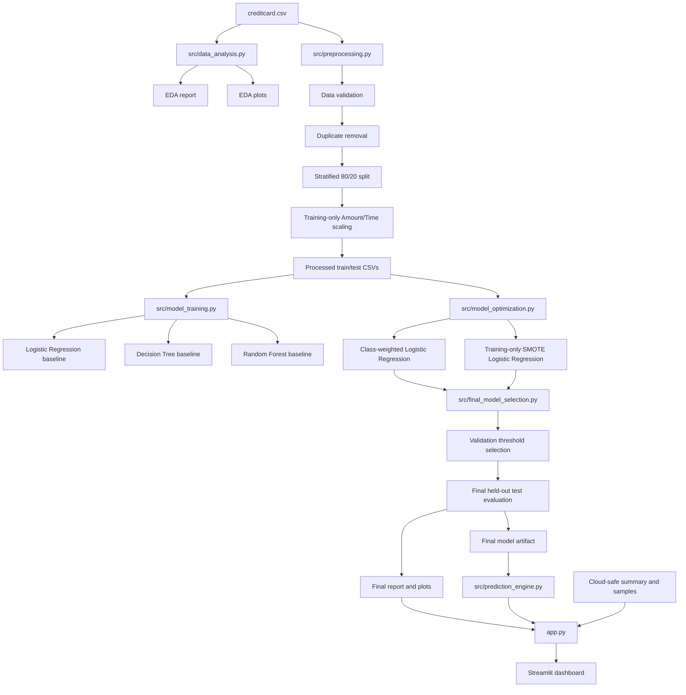

# System Architecture

## Overview

This project is a reproducible offline machine-learning workflow plus a Streamlit user interface. It does not use external APIs or live banking feeds.

## Components

### Raw Data and EDA

- `data/creditcard.csv` is the raw public dataset.
- `src/data_analysis.py` calculates class distribution, missing values, duplicates, and data types.
- EDA outputs are stored in `reports/eda_report.txt` and `reports/plots/`.

### Preprocessing

- `src/preprocessing.py` validates the `Class` target and numeric features.
- It removes exact duplicates from an in-memory copy.
- It creates a stratified 80/20 split with seed 42.
- `Amount` and `Time` use a fitted standardizer.
- The same fitted scaler is applied to test and prediction inputs.
- Raw data is never modified.

### Training and Optimization

- `src/model_training.py` implements three baseline models.
- `src/model_optimization.py` tests class weights and training-only SMOTE.
- Validation data is derived from training data for threshold tuning.
- The final test partition remains unseen until final evaluation.

### Final Selection

- `src/final_model_selection.py` reviews threshold candidates using validation F1-score.
- It selects the class-weighted Logistic Regression model with threshold 0.40.
- It saves `models/final_fraud_model.joblib` and `reports/final_model_evaluation.txt`.

### Prediction Engine

- `src/prediction_engine.py` validates feature names and values.
- It loads the saved model and scaler.
- It applies the 30 features in their exact saved order.
- It applies threshold 0.40 rather than 0.50.
- It returns label, probability, risk percentage, risk category, threshold, and explanation.
- `src/predict.py` provides a simple command-line interface.

### Dashboard

- `app.py` is the Streamlit entry point.
- `src/dashboard.py` provides data summaries, filtering, and report parsing.
- The dashboard has overview, analytics, prediction, performance, and data-explorer sections.
- Streamlit caches the dataset and model artifact.
- In cloud mode, full raw data is excluded and small aggregate assets are used.

## Deployment Files

- `models/final_fraud_model.joblib`: final model artifact.
- `data/processed/amount_time_scaler.joblib`: required preprocessing scaler.
- `data/deployment/summary.json`: actual aggregate dashboard values.
- `data/deployment/test_samples.csv`: 50 held-out test samples.
- `.streamlit/config.toml`: headless Streamlit configuration.
- `reports/final_model_evaluation.txt`: source for dashboard metrics.

## Security and Data Boundaries

- Raw `creditcard.csv` is excluded by `.gitignore`.
- Full processed CSVs are excluded.
- Experimental model files are excluded; the final model and scaler are deployment exceptions.
- No API keys or secrets are used.
- The cloud bundle contains public aggregate statistics and held-out demonstration values.

## Scaling and Prediction Boundary

The engine receives values in the original `Time` and `Amount` scale, matching the manual-input convention. It loads the saved scaler and transforms `Amount` and `Time` before calling the model.
