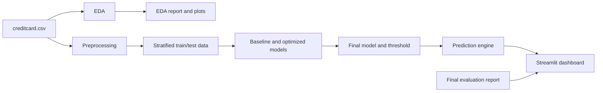

# AI-Based Credit Card Fraud Detection System

A complete Python and Streamlit project for exploring credit-card transaction data, comparing fraud-detection models, and generating explainable fraud risk predictions.

> This project is educational and is not a production fraud-prevention system.

## Problem Statement

Fraudulent transactions are rare compared with legitimate activity. A basic model can appear highly accurate while failing to identify most fraud. This project evaluates fraud recall, precision, F1-score, PR-AUC, ROC-AUC, and confusion-matrix errors rather than relying on accuracy alone.

## Objectives

- Analyze transaction distributions and class imbalance.
- Clean duplicate records while preserving the original raw data.
- Preserve a reproducible stratified train-test split.
- Standardize `Amount` and `Time` without test-set preprocessing leakage.
- Compare Logistic Regression, Decision Tree, and Random Forest baselines.
- Experiment with class weights and training-only SMOTE.
- Select a final fraud-oriented model and decision threshold.
- Provide reusable prediction and interactive Streamlit interfaces.

## Dashboard Features

- Executive overview and transaction counts.
- Fraud analytics for amount and time patterns.
- 30-feature transaction prediction.
- Fraud probability, risk percentage, risk category, and decision threshold.
- Actual Phase 6 model metrics and confusion matrix.
- Filterable data explorer in local mode.
- Cloud-safe aggregate fallback.

## Technologies

- Python
- Pandas and NumPy
- Matplotlib and Seaborn
- Streamlit
- Joblib
- pytest
- GitHub preparation

Custom NumPy/Pandas implementations are used for the baseline and optimized models because native scikit-learn modules are blocked in the current Windows environment.

## Dataset

The project uses the public [Kaggle Credit Card Fraud Detection dataset](https://www.kaggle.com/datasets/mlg-ulb/creditcardfraud).

- 284,807 transactions
- 31 columns
- Target `Class`: 0 is legitimate and 1 is fraudulent
- Missing values: 0
- Duplicate records: 1,081
- Legitimate: 284,315 (99.8273%)
- Fraudulent: 492 (0.1727%)

The raw dataset and full processed CSVs are excluded from Git. A cloud-safe aggregate summary and 50 held-out test samples are included.

## Machine-Learning Workflow

1. EDA identified data types, missing values, duplicates, and class imbalance.
2. Duplicate rows were removed from an in-memory copy.
3. `Class` was separated from the 30 predictor features.
4. An 80/20 stratified split used random seed 42.
5. Training-only statistics standardized `Amount` and `Time`; `V1`–`V28` were not scaled again.
6. Baseline and optimized models were evaluated on the preserved test set.
7. Validation data was used for threshold and model selection.

No balancing was applied to the final held-out test set.

## Models and Actual Results

The test set contains 56,746 transactions: 56,651 legitimate and 95 fraudulent.

| Approach | Precision | Recall | F1 | Accuracy | ROC-AUC | PR-AUC | FP | FN |
|---|---:|---:|---:|---:|---:|---:|---:|---:|
| Logistic baseline | 0.850000 | 0.536842 | 0.658065 | 99.9066% | 0.987232 | 0.772023 | 9 | 44 |
| Decision Tree baseline | 0.785714 | 0.694737 | 0.737430 | 99.9172% | 0.950471 | 0.757173 | 18 | 29 |
| Random Forest baseline | 0.857143 | 0.631579 | 0.727273 | 99.9207% | 0.976246 | 0.730199 | 10 | 35 |
| Class-weighted Logistic Regression | 0.826087 | 0.800000 | 0.812834 | 99.9383% | 0.988116 | 0.774204 | 16 | 19 |
| SMOTE Logistic Regression | 0.291667 | 0.884211 | 0.438642 | 99.6211% | 0.985326 | 0.750227 | 204 | 11 |

### Final Model

The final model is class-weighted Logistic Regression with fraud weight 5 and threshold 0.40.

- True negatives: 56,635
- False positives: 16
- False negatives: 19
- True positives: 76
- Precision: 0.826087
- Recall: 0.800000
- F1-score: 0.812834
- Accuracy: 99.9383%
- ROC-AUC: 0.988116
- PR-AUC: 0.774204

It improved baseline logistic recall from 53.68% to 80%, with fewer false positives than SMOTE. SMOTE found four more frauds but generated 204 false positives.

## Architecture

See [ARCHITECTURE.md](ARCHITECTURE.md) for the actual implementation and data flow.



## Installation

```powershell
python -m venv .venv
.\.venv\Scripts\Activate.ps1
python -m pip install --upgrade pip
python -m pip install -r requirements-dev.txt
```

`requirements.txt` contains the dashboard runtime dependencies used by Streamlit Community Cloud. The development file adds test and exploratory-analysis dependencies.

## Run the Dashboard

```powershell
python -m streamlit run app.py
```

Open `http://localhost:8501`.

## Run the Prediction CLI

```powershell
python src\predict.py --test-row 0
```

This uses held-out test data, not a real banking transaction.

## Run Tests

```powershell
python -m pytest -q
```

The latest executed suite reported **38 tests passed**.

## Project Structure

```text
AI-Fraud-Detection-System/
├── app.py
├── data/
│   ├── creditcard.csv                 # excluded from Git
│   ├── processed/                     # split and scaler, mostly excluded
│   └── deployment/                    # cloud-safe summary and samples
├── models/
│   └── final_fraud_model.joblib
├── reports/
│   ├── baseline_model_report.txt
│   ├── phase5_experiment_report.txt
│   ├── final_model_evaluation.txt
│   └── plots/
├── src/
│   ├── data_analysis.py
│   ├── preprocessing.py
│   ├── model_training.py
│   ├── model_optimization.py
│   ├── final_model_selection.py
│   ├── prediction_engine.py
│   ├── predict.py
│   └── dashboard.py
├── tests/
├── .streamlit/config.toml
├── requirements.txt
├── requirements-dev.txt
└── .gitignore
```

## Testing

The project uses pytest. Existing tests cover data validation and splitting, preprocessing and scaling, model metrics, class balancing and threshold search, final model selection, prediction input, dashboard filters, report parsing, and Streamlit loading.

## Limitations

- The model is not production-ready.
- Results came from one public dataset and one held-out test partition.
- The threshold is project-specific, not universal.
- False positives add investigation cost; false negatives allow fraud to pass.
- The dashboard has no live transaction feed or external API.
- Cloud mode uses aggregate statistics and limited test samples rather than the full data explorer.

## Future Improvements

- Add cross-validation and calibrated probabilities.
- Add stronger ensemble implementations.
- Add cost-sensitive threshold optimization.
- Use temporal validation.
- Add monitoring and drift detection.
- Add batch CSV prediction.
- Add screenshots after deployment if the project is published.

## GitHub Preparation

Git is not initialized in the current project directory. Suggested commit sequence after the user creates/initializes the repository:

1. Commit setup, requirements, and ignore rules.
2. Commit EDA and preprocessing code with reports and plots.
3. Commit baseline and optimization code plus reports.
4. Commit final model, scaler, prediction engine, dashboard, tests, and documentation.
5. Exclude the raw dataset, full processed split CSVs, virtual environment, caches, and secrets.

No commit or remote configuration has been created.

## Deployment Status

Local Streamlit execution is verified. GitHub publication and Streamlit Community Cloud deployment have not occurred and require explicit confirmation.

The main application file is `app.py`; no API credentials are required.
